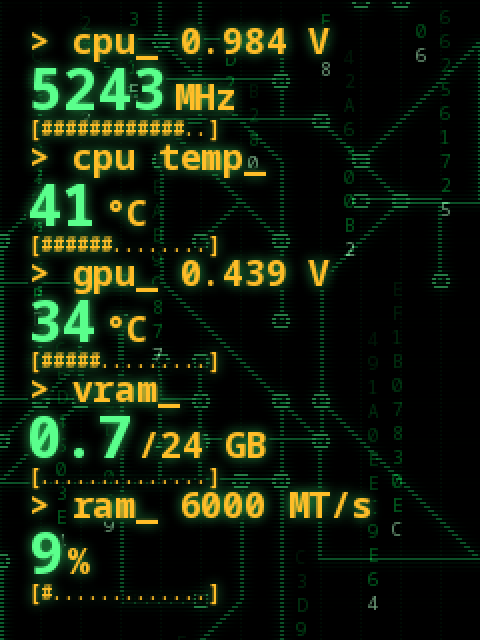

# ryujin-lcd

A live hacker-style dashboard for the 3.5" LCD of the **ASUS ROG Ryujin II** AIO cooler on Linux,
without Armoury Crate.



- **5 rows:** CPU clock + core voltage, CPU temperature, GPU temperature + voltage, VRAM, RAM % + speed.
- Falling hex "Matrix" code over a green circuit background (or your own picture, in a wireframe look).
- **Colour-blind friendly:** labels and numbers differ by size and brightness, not only by hue;
  temperature warnings are shown as text (`WARM`, `HOT!`).
- **Your own picture while the PC is off** (optional): stored on the cooler as a GIF, shown instead of the ROG animation.
- Runs as a sandboxed systemd service (no network, no root, only the cooler's USB device).

The PC draws every frame and streams it to the cooler 10 times a second. Nothing is written to the
cooler's storage for the dashboard itself.

> **Use at your own risk.** Unofficial project, not affiliated with or endorsed by ASUS. It talks to
> the cooler with reverse-engineered commands and was tested on **one** Ryujin II (USB `0b05:1988`,
> firmware `AURJ1-S750-0104`) with Fedora 44. It never sends pump or fan commands, but there is no
> warranty (see [LICENSE](LICENSE)): you are responsible for what it does to your hardware.
> Problems you find are welcome as issues; the author will not run risky tests on their own cooler.

## Requirements

- ASUS ROG Ryujin II with its USB cable connected to the motherboard (`lsusb` shows `0b05:1988`).
- Python 3, **Pillow** and **pyusb**:
  - Fedora: `sudo dnf install python3-pillow python3-pyusb`
  - Debian / Ubuntu: `sudo apt install python3-pil python3-usb`
  - Arch: `sudo pacman -S python-pillow python-pyusb`
- Optional, for the CPU voltage: the `nct6775` driver (most ASUS boards):
  `echo nct6775 | sudo tee /etc/modules-load.d/nct6775.conf && sudo modprobe nct6775`
- Armoury Crate, SignalRGB or other tools that drive the screen must **not** run at the same time.

What is read: CPU clock (cpufreq), CPU temperature (AMD `k10temp` or Intel `coretemp`), GPU values
from AMD cards (`amdgpu`; NVIDIA is not read and shows `--`), RAM from `/proc/meminfo`.

## Install

```sh
git clone https://github.com/vigilwire/ryujin-lcd.git
cd ryujin-lcd
sudo sh install.sh
```

The screen switches to the dashboard within a few seconds. `install.sh` creates the group
`ryujin-lcd`, a udev rule for the cooler, the service `ryujin-lcd-monitor` and `/etc/ryujin-lcd.conf`.
Running it again updates the script but keeps your settings and background.

Remove: `sudo sh uninstall.sh` (the screen goes back to the ROG animation).

## Settings

Edit `/etc/ryujin-lcd.conf`, then `sudo systemctl restart ryujin-lcd-monitor`. See
[ryujin-lcd.conf.example](ryujin-lcd.conf.example) for all keys: rotation, GPU, font, background,
frame rate, falling-code brightness, GIF slot.

## Your own background

```sh
python3 make_background.py my-picture.jpg     # wireframe look, writes assets/background.png
sudo install -m 0644 assets/background.png /usr/local/share/ryujin-lcd/background.png
sudo systemctl restart ryujin-lcd-monitor
```

Keep it dark: the numbers are drawn on top. Without a picture, `make_background.py` draws the circuit grid.

## Your own picture while the PC is off (optional)

The cooler keeps its screen powered while the PC is off and shows whatever it played last. To show
your picture instead of the ROG animation, store it once as a GIF:

After live streaming, the cooler ignores all commands until it loses power. Stopping the service
or reconnecting the USB device in software is **not** enough. So upload from a fresh start, with
the dashboard turned off:

```sh
python3 offline_gif.py make [picture]        # offline.gif; default = your dashboard background
sudo systemctl disable --now ryujin-lcd-monitor
sudo poweroff                                # full shutdown (not reboot), then switch the PC on again
sudo python3 offline_gif.py slots            # shows which GIF slots are in use
sudo python3 offline_gif.py upload 0         # use a FREE slot (it refuses a used one)
sudo python3 offline_gif.py play 0           # check it on the screen
```

Then set `OFFLINE_GIF_SLOT=0` in `/etc/ryujin-lcd.conf` and `sudo systemctl enable --now ryujin-lcd-monitor`.
From now on, every shutdown shows your picture. The tool cannot delete stored files (on purpose).

## Troubleshooting

| Symptom | Fix |
|---|---|
| ROG animation (or your offline picture) while the PC is on | `systemctl status ryujin-lcd-monitor` and `journalctl -u ryujin-lcd-monitor -n 20`; is another program using the cooler? |
| `device error … retrying` every few seconds | USB permissions: `ls -l /dev/hidraw*` should show group `ryujin-lcd`; run `install.sh` again |
| `-- V` beside cpu | load `nct6775` (see Requirements) |
| GPU shows `--` | NVIDIA card, or set `GPU_PCI` in the config |
| Picture sideways / upside down | `ROTATE` (0/90/180/270) |
| `offline_gif.py`: `no answer from the cooler` | it streamed since it last had power: see the steps above (disable service, full power-off) |
| `sensors` shows timeouts for `rog_ryujin` | normal while the dashboard runs: the cooler answers no requests during live streaming |

## How it works

See [docs/protocol.md](docs/protocol.md): the live-frame protocol, the stored-GIF sequence, Ryujin II
findings and dead ends. Every packet is checked against an allow-list before it is sent;
pump/fan and delete/format commands are impossible by design.

## Credits

- [zenstrukt/signalrgb-device-plugins](https://github.com/zenstrukt/signalrgb-device-plugins) (MIT) — the Ryujin II live-frame protocol.
- [zaclanzon/ryujin-iii-lcd-linux](https://github.com/zaclanzon/ryujin-iii-lcd-linux) (MIT) — the file upload and play commands (Ryujin III, same controller).

Written with help from Claude (Anthropic).

## License

[MIT](LICENSE)
